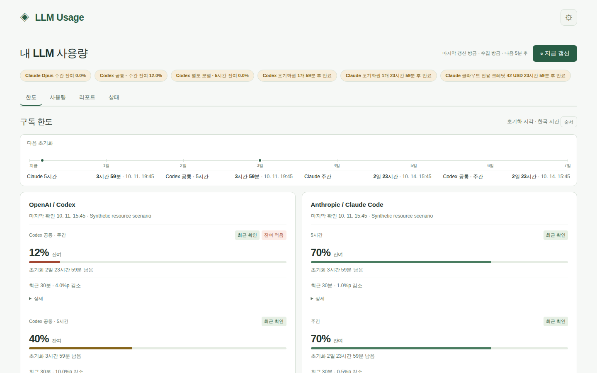

# LLM Usage Dashboard

개인 LLM 도구의 **구독 한도·초기화권·크레딧과 기록된 토큰 사용량**을 확인하는 자체 호스팅 대시보드입니다.
Linux/WSL에서 실행하며 Tailscale 소유자 계정으로만 접근합니다. 웹과 수집기는 독립 프로세스이고 Resource Guard는 필요하지 않습니다.

A self-hosted dashboard for LLM quotas and usage. Linux/WSL, private Tailscale access, local-first collection. Korean UI and documentation. Independent project; not an official provider product.

현재 릴리스: **[v0.9.1](https://github.com/jihoon22-lee/llm-usage-dashboard/releases/tag/v0.9.1)** · [변경 기록](CHANGELOG.md)

수집 기준: [클라우드 누계 대조·한국시간 미배분량·선택적 telemetry](docs/collection-reconciliation.md).

## 기능

- 한도·사용량·리포트·상태 네 탭: 잔여 한도·다음 초기화·보유 초기화권과 크레딧 확인
- 사용량 안의 토큰 분석·한도 소비·클라우드 및 리뷰 목록: 기능/모델별 일별 소비율과 작업·PR·실행 상태, 일부 작업의 소비 상세
- 최근 1시간 빠른 보기: 정확한 60분의 로컬 기록을 서비스·모델·프로젝트·세션별로 집계하고 CSV로 내보내기
- 한도별 실제 감소량: 최근 30분 안의 연속 관측 구간과 감소한 %p 표시, 작업 지속 시간은 예측하지 않음
- 보유 초기화권·크레딧을 확인된 만료일 순으로 표시하고 24시간 이내 만료 알림 제공
- Codex·Claude 자원 읽기 전용 조회와 모바일 대화상자로 입력하는 수동 기록
- 지출 한도는 크레딧 사용 조건으로 구분, 수치 미수신은 빈 카드 대신 짧은 상태 안내
- 조회 실패한 기존 잔액은 마지막 확인값으로 보존하고 0·만료·이전 계정 기록은 접어서 표시
- 캐시·추론 구분, 스트리밍·재수집·Windows/WSL 사본 중복 제거
- 데스크톱·모바일, CSV, 제한된 오프라인 통계 사본, 선택적 외부 알림
- 없는 원본 값을 0이나 100%로 채우지 않고 미제공·실패·오래된 관측을 구분
- Claude 계정 여러 개(zerosub·paseo 등 `CLAUDE_CONFIG_DIR`별 로그인): 하나의 Claude Code 서비스 안에서 계정별 한도·초기화·토큰 사용량·구독 가치를 구분
- 설정에서 구독 종료를 표시하면 그 서비스의 한도 조회·알림을 멈추고 한도 카드를 접음(사용 기록은 계속 집계)
- 리포트 탭: 이번 주 현황(지난주 같은 시점 대비), 주간 리포트(한도 활용·Claude 계정별·상위 프로젝트), 월간 구독 결산(구독료 대비 배수·월별 추이)

## 지원 범위

| 도구 | 토큰 원본 | 한도 경로 | 제한 |
|---|---|---|---|
| Codex | 로컬 JSONL, 계정 합계·스레드 상세 기능 조회(App Server) | 기존 CLI App Server, 크레딧·초기화권 | 계정 집계 범위는 KST 09:00–다음 날 09:00. 날짜 미배분량을 별도 표시하며 차이를 dot 사용량으로 단정하지 않음. 모델·프로젝트 보기에서 차이는 이름을 정할 수 있는 별도 항목. 스레드 상세는 미제공일 수 있음 |
| Claude Code | 로컬 JSONL, 클라우드 transcript·전체 이벤트·modelUsage | 기존 OAuth·상태줄, 선불 잔액·지출 조건·초기화권 | 하위 에이전트 누락과 최종 누계를 대조. 내부 OAuth·세션 API의 외부 연동 허용은 확인되지 않았으며 공식 지원으로 보장하지 않음. 누계 감소·복원 범위가 모호한 이력은 충돌 표시 |
| Antigravity | CLI/앱 SQLite | 상태줄·실행 중인 WSL 앱 | 내부 스키마/RPC 변경에 영향받음 |
| OpenCode Go | 로컬 SQLite | 계정 usage 경로 | 구독 계정의 실제 한도 수신 미검증 |
| Devin CLI | 로컬 SQLite | 기존 CLI 계정 경로 | 내부 API, Cloud 세션 미지원 |

Codex 부분 응답에서 계정 ID가 빠져도 저장된 계정 유형·이메일 기반 revision이 일치하면 기존 계정 합계를 유지합니다. 이는 인증 토큰 일치 검사가 아니며, 다른 계정 ID나 변경된 revision은 별도 계정으로 처리합니다. Claude 보조 `events` API의 404는 보조 조회만 세션 변경 또는 24시간 뒤에 재시도하며, 최근 15분 내 갱신된 세션의 본문 조회는 계속합니다. 두 경계 조건은 합성 응답으로 검증했으며 실제 계정 장애 재현은 수행하지 않았습니다.

Claude 계정이 여러 개면 각 설정 홈의 로그인으로 한도·자원·클라우드 세션을 따로 조회하고, 공유 transcript의 요청은 llm-usage Claude Code 훅(턴마다 세션·해시된 계정 기록)과 Claude Code 프로세스 기록으로 계정에 배정합니다. 두 번째 계정이 생기기 전 기록은 원래 계정, 근거가 없는 이후 요청은 ‘계정 미확인’으로 따로 집계하며 추정해 합치지 않습니다. llm-usage 훅이 실행되지 않고 프로세스 기록도 남지 않은 세션(실제 사례: Python Agent SDK 실행)의 요청도 여기에 들어갑니다. 훅은 `llm-usage install-hooks`로 명시적으로 연결합니다. 이메일·이름은 저장하지 않아 계정은 요금제 이름이나 설정에서 정한 표시 이름으로 보입니다. 클라우드 세션의 `modelUsage` 누계는 읽은 로그인의 조직 키로 저장해 그 계정에 붙이므로, 같은 조직의 로그인끼리는 누계를 구분하지 못합니다. 이전 버전이 키 없이 저장한 누계는 같은 세션의 근거가 있을 때만 계정을 붙이고 근거가 없으면 원래 계정에 남깁니다. [Claude 계정 구분](docs/architecture.md#claude-계정-구분)을 확인하세요.

기본 Claude 홈에 로그인이 없어도 식별된 다른 홈의 단독 transcript는 그 계정으로 집계합니다. 같은 계정으로 나중에 기본 홈에 로그인해도 최초 계정 경로를 유지해 사용량·구독료·자원이 갈라지지 않습니다. 이전 버전의 잘못된 기본 계정 배정은 기본 계정이 아직 미확정이고 원본 폴더의 소유가 명확할 때 한 번 보정합니다. 이미 기본 계정이 확정됐거나 같은 세션이 여러 독립 폴더에 있으면 과거 계정을 입증할 수 없어 자동 이동하지 않습니다. 클라우드에서 확정한 귀속은 유지합니다.

선택된 사용자 홈·명시한 Claude 홈·허용된 훅 관측에서 발견한 `projects` 폴더는 자동 수집하고, 기존 경로와 같은 심볼릭 링크는 중복 등록하지 않습니다. 요청 ID에 연결된 Claude telemetry의 계정/조직 UUID는 해시한 귀속 근거로 사용할 수 있으며 이메일·익명 설치 ID는 계정 근거로 쓰지 않습니다. 선택적 exporter가 연결되지 않은 SDK/headless 실행은 계속 미확인으로 남을 수 있습니다.

[구조와 수집 경로](docs/architecture.md)에서 과거 실수신과 합성 검증을 구분합니다.
Windows는 선택한 프로필의 **기록 수집 대상**입니다. Windows/macOS 네이티브 서버 설치는 지원하지 않습니다.

Codex의 `token_usage_record`는 요청 ID별로 보존하고 연결된 누계 이벤트를 대신해 한 번만 집계합니다. 누계만 남은 과거 기록은 보존하며, 연결이 모호하거나 원본이 상충하면 수집 상태에 표시합니다. `.jsonl.zst` 압축 기록과 압축 전후 사본도 처리합니다. Codex telemetry는 원본 응답 ID가 확인될 때 연결하며 실제 exporter가 연결되지 않은 상태는 실수신 완료로 표시하지 않습니다.

Codex 클라우드·자동 리뷰는 [실계정 추가 검증](workthrough/2026-10-24-cloud-review-verification.md)에서 리뷰 목록·PR·모델·실행 상태와 일부 작업의 모델별 한도 소비율을 조회할 수 있음을 확인했습니다. 웹의 `daily-token-usage-breakdown` 응답도 확인한 개인 Pro 계정에서는 단위가 `percent`였으며 원본 토큰 수가 아니었습니다. 0.9.0부터 기존 Codex CLI 인증으로 이 경로를 주기 수집하고, 사용량 탭에서 토큰과 별도로 표시합니다. 내부 경로이므로 제공사 변경에 영향받으며 전체 ChatGPT·dot 세션 목록을 보장하지 않습니다. 작업별 토큰·입출력·캐시 분해는 여전히 확보하지 못했으며, 계정 차액이나 한도 소비율을 리뷰 토큰으로 바꾸지 않습니다.

[대시보드 통합 검토](workthrough/2026-10-24-cloud-review-verification.md#dashboard-integration-review)에는 사용량 안의 토큰 분석·한도 소비·클라우드 및 리뷰 목록, 한도에서 소비 분석으로 이동하는 연결, 수집 상태 표시와 구현 순서를 정리했습니다. 0.9.0의 구현·실계정 검증 결과와 남은 범위도 같은 기록에서 확인할 수 있습니다.

한도 소비의 모델명을 확인해도 소비율만으로 원본 토큰이나 금액을 계산할 수는 없습니다. 구독 가치 분석은 원본 토큰량과 단가가 확인된 요청 기록을 환산하며, 소비율만 받은 사용은 추가하지 않습니다.

Claude `advisor_message`는 부모 요청에 연결된 별도 모델 소비로 포함하고 내부 호출 수를 API 요청 수와 구분합니다. 중첩 thinking 필드와 캐시 생성의 5분·1시간 분해를 보존하며 출력·전체 생성 토큰에 다시 더하지 않습니다. 캐시 분해가 원본 합계와 맞지 않거나 서로 상충하면 전체 토큰은 보존하고 분해만 미확인으로 표시합니다. TTL이나 해당 단가가 없는 생성량은 기존 기본 단가로 추정합니다. 삭제된 원본의 reasoning·TTL은 소급 복구할 수 없습니다. [원본 대조·재현·보완 기록](workthrough/2026-10-23-collection-coverage.md)을 확인하세요.

일일 원본 대조는 Codex 요청별 일반·압축 기록, Claude 부모·advisor, OpenCode와 기존 누계·Antigravity·Devin을 수집기와 별도로 읽어 검사합니다. 수집 완료 지점 뒤의 새 기록은 대기, 해석 실패·세부값 상충·현재 원본보다 큰 과거 보존값은 부분 확인으로 구분합니다. 실제 누락과 숫자 불일치는 오류로 표시하며, 삭제된 원본까지 검증됐다고 간주하지 않습니다.

최근 1시간은 계정 전체나 현재 실행 중인 작업이 아닌 **수집된 로컬 사용 기록**을 보여 줍니다. 프로젝트·세션 정보가 없는 기록도 전체 합계에 포함하며 미분류·미귀속을 표시합니다. 요약과 상세는 같은 시간 범위를 사용합니다. 한도 감소량은 계정·출처·초기화·수집 공백을 구분한 연속 15분 이상의 관측이 있을 때만 표시합니다. 확인된 감소량 0과 관측 부족은 다르며, 부족한 이력으로 예측 카드를 만들지 않습니다.

리포트의 한도 활용은 보존 기간(기본 30일) 안에서 10분 이하 간격으로 이어진 관측만 계산합니다. 계정 확인 전 이력, 10분보다 긴 측정 간격, 수집 실패가 기록된 구간은 관측 시간에 넣지 않습니다. 소진 횟수도 같은 계정 확인 시각 이후의 측정값 변화만 셉니다. 긴 간격·실패 때문에 관측 시간이 없는 창은 ‘미관측’으로 표시하며 소진 횟수는 남을 수 있습니다. 수정 후 저장 리포트·결산을 한 번 다시 계산하지만, 원본 한도 이력이 이미 삭제된 구간은 과거 저장값을 보존하며 소진 횟수의 재검증을 보장하지 않습니다. 월간 구독 결산은 KST 달력 월의 리스트 가격 환산이라 실제 청구 주기와 다를 수 있습니다. 구독료를 바꾸면 설정에서 적용 시점을 정하고, 구독 가치와 결산은 기간 안의 구독료를 적용 시간에 비례해 나눕니다(실제 일할 청구·크레딧과 다를 수 있음). 처음 거슬러 결산하는 달은 그 시점의 월 구독료를 쓰고, 최근 두 달보다 오래된 결산은 형식이 바뀔 때만 다시 계산합니다. 외부 알림의 ‘초기화 전 남은 한도’는 기본으로 꺼져 있고, 제공사가 알려 준 초기화 시각과 서비스 공통 창만 씁니다.

추가 자원의 잔액·지출 한도·초기화권 횟수는 합산하지 않습니다. Claude 클라우드 세션 전용 크레딧은 별도 잔액·만료로 표시하며 로컬 구독 한도에 합산하지 않습니다. API 전용 크레딧은 수동 기록을 지원하며 구독형 작업의 보유 자원과 합산하지 않습니다. 조회·기록만 제공하고 초기화권 사용·크레딧 구매·자동 충전 설정 변경은 실행하지 않습니다. [화면과 자원 조건](docs/usage.md)을 확인하세요.



이미지는 개인 데이터가 없는 합성 예시입니다.

## 빠른 시작

Python 3.11+, uv 0.12.23, Git, systemd가 실행되는 Linux/WSL, 로그인된 Tailscale과 HTTPS Serve 환경이 필요합니다.
서버 경로·홈에는 ASCII 영문자·숫자·`_ . / -`만 사용할 수 있습니다. 먼저 [설치 안내](docs/setup.md)를 확인하세요.

```bash
git clone --branch v0.9.1 https://github.com/jihoon22-lee/llm-usage-dashboard.git
cd llm-usage-dashboard
git switch -c main
uv sync --locked --no-dev
.venv/bin/llm-usage init
.venv/bin/llm-usage collect --once
sudo ./install.sh --owner "$USER"
```

v0.9.1의 고정된 설치 절차입니다. 태그 clone의 detached HEAD에서 설치·업데이트용 로컬 main을 생성합니다. 개발 최신 코드는 원격 main을 사용하세요. 기존 v0.1.0에는 uv.lock이 없으며, 업데이트는 [의존성 전환 안내](docs/operations.md)를 따릅니다.

수집은 로컬 기록을 읽고 기존 인증으로 계정 한도를 조회합니다. Windows와 상태줄 연결은 [명시적으로 선택](docs/setup.md)합니다.
설치기가 출력하는 개인 Tailscale 주소로 접속합니다. Funnel로 인터넷에 공개하지 않습니다.
Git checkout이 서비스 설치·업데이트의 공식 경로입니다. Release의 wheel·소스 배포본은 CLI/웹 런타임이며 단독 서비스 설치기가 아닙니다. 릴리스의 `SHA256SUMS`와 `release-manifest.json`으로 산출물 무결성과 검증한 커밋을 확인할 수 있습니다.

## 문서

- [설치와 설정](docs/setup.md), [화면과 CLI](docs/usage.md)
- [구조·API·데이터 의미](docs/architecture.md), [운영·백업·복구](docs/operations.md)
- [개발·검증·기여](CONTRIBUTING.md), [보안·개인정보](SECURITY.md), [변경 기록](CHANGELOG.md)

비용은 API 단가로 환산한 추정이며 구독 청구액이나 실제 크레딧 차감액이 아닙니다. 비용 추이 CSV의 빈 비용은 미산정이며, 부분 산정 범위는 함께 내보내는 미산정 토큰 열로 확인합니다. 내부 제공사 API는 변경될 수 있습니다. 초기화권별 상세·만료·크레딧 단위가 미제공이면 임의로 채우지 않습니다.
본문을 저장하지 않아도 세션 ID·프로젝트명·사용 시각은 개인 정보가 될 수 있습니다. 실제 DB·화면·원본 로그를 공개 이슈에 올리지 마세요.
기존 DB의 경로형 프로젝트명은 자동 변환하지 않아 신규 이름과 분리되거나 예산 재설정이 필요할 수 있습니다.

[MIT 라이선스](LICENSE)입니다.
